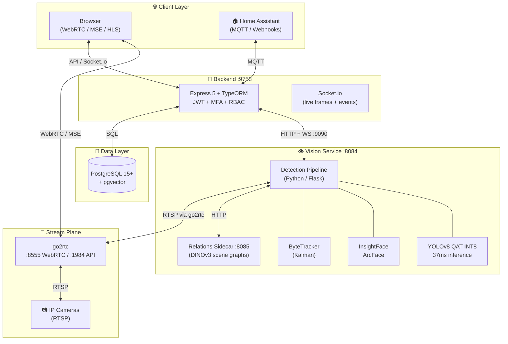
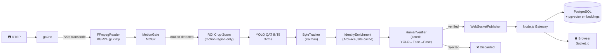

<p align="center">
  
</p>

<p align="center">
  
  
  
  
  
</p>

<p align="center">
  
  
  
</p>

<p align="center">
  <a href="#-quick-start"><strong>Quick Start</strong></a> •
  <a href="#-architecture"><strong>Architecture</strong></a> •
  <a href="#-capabilities"><strong>Capabilities</strong></a> •
  <a href="#-documentation"><strong>Documentation</strong></a> •
  <a href="#-tech-stack"><strong>Tech Stack</strong></a> •
  <a href="#-contributing"><strong>Contributing</strong></a>
</p>

---

## 🎯 Why SentryVision?

<table>
<tr>
<th width="50%">🔒 Traditional Cloud Cameras</th>
<th width="50%">✨ SentryVision</th>
</tr>
<tr>
<td>📹 Footage leaves your network</td>
<td>🔒 <strong>100% local — nothing ever leaves</strong></td>
</tr>
<tr>
<td>💸 Monthly subscriptions forever</td>
<td>💰 <strong>One-time hardware, zero recurring cost</strong></td>
</tr>
<tr>
<td>☁️ Vendor lock-in, API changes</td>
<td>🛠 <strong>You own the stack, you control the roadmap</strong></td>
</tr>
<tr>
<td>🎯 Basic motion alerts</td>
<td>🧠 <strong>AI: person/vehicle/animal + face recognition + threat assessment</strong></td>
</tr>
<tr>
<td>📱 App-only access</td>
<td>🌐 <strong>Browser, API, Webhooks, Home Assistant, MQTT</strong></td>
</tr>
<tr>
<td>📊 Limited retention</td>
<td>📈 <strong>Unlimited retention, 25+ analytics dimensions</strong></td>
</tr>
</table>

**Built for the self-hosted community.** Runs on any Docker-capable hardware — Intel NUC, mini-PC, homelab server. One-command install. Production-grade.

---

## 🚀 <a id="capabilities"></a>Capabilities

<details open>
<summary><strong>🔴 Real-Time Intelligence</strong></summary>

| Feature | Description | Performance |
|---------|-------------|-------------|
| **Dual-Chain Object Detection** | QAT INT8: CrowdHuman v8s (persons) + COCO QAT (vehicles/animals) | **37–39ms inference** |
| **Motion ROI Crop-Zoom** | Frigate-style: YOLO runs on motion region only | Cuts inference area ~80% |
| **Human Verification** | Tiered: YOLO ≥0.90 → Face → MediaPipe pose → score floor | Discards non-human tracks |
| **Face Recognition** | InsightFace ArcFace 512-dim embeddings, 30s identity cache | Visitor timeline + known faces |
| **Multi-Object Tracking** | ByteTracker (Kalman filter, lifecycle: started/updated/ended) | Stable IDs across frames |
| **Motion Gating** | MOG2 background subtraction (pixel threshold, 10-frame warmup) | YOLO fires only on motion |

</details>

<details>
<summary><strong>📺 Live Streaming (go2rtc)</strong></summary>

| Protocol | Latency | Use Case |
|----------|---------|----------|
| **WebRTC** | **<200ms** LAN | Desktop, mobile — lowest latency |
| **MSE/fMP4** | ~500ms | VPN, Tailscale, Cloudflare Tunnel (TCP-only) |
| **HLS** | ~2s | Wide compatibility, CDN-friendly |
| **Canvas Fallback** | ~1s | Zero-config last resort (Socket.io JPEG) |

**Adaptive quality**: grid tiles pull the 720p substream; focused/fullscreen pulls native resolution. Automatic — no configuration needed.

</details>

<details>
<summary><strong>🧠 AI & Analytics</strong></summary>

- **Semantic Event Search** — pgvector + MiniLM embeddings: *"person in red jacket at front door last week"*
- **AI Chat (Ask)** — Natural language queries with full event-archive access: *"Show me all cars after 10pm last week"*
- **Scene Relations** — RelateAnything sidecar (DINOv3): spatial relationships between objects ("person *near* vehicle")
- **Threat Assessment** — LLM-grounded analysis using stored scene relations, not raw pixel narration
- **Daily Digest** — Auto-generated daily summaries with highlights
- **Review Workflow** — Event-driven segment triage (confirm/dismiss/escalate)
- **Timelapse** — Full-resolution stitching from detection snapshots
- **Daily Insights** — 25+ dimensions: detection patterns, dwell time, visitor frequency

</details>

<details>
<summary><strong>🏢 Enterprise & Integration</strong></summary>

- **Multi-User + RBAC** — Admin/User/Viewer roles with granular permissions
- **TOTP MFA** — Google Authenticator / Authy compatible
- **JWT Auth** — 15min access / 7day refresh with rotation + 401 auto-refresh
- **Home Assistant** — MQTT discovery, webhooks, camera entities
- **Webhooks + MQTT** — Real-time event push to any system
- **Audit Logging** — Full trail of sensitive operations
- **Rate Limiting** — Per-endpoint protection
- **Security Headers** — Helmet.js (CSP, HSTS, X-Frame-Options)

</details>

---

## 🏗 <a id="architecture"></a>Architecture



### Design Decisions That Matter

| Decision | Rationale |
|----------|-----------|
| **Single Container (Backend + Frontend)** | One deploy target, simpler networking, smaller attack surface |
| **No Redis by Default** | In-memory cache saves ~150MB RAM; Redis optional (`REDIS_DISABLED=false`) |
| **go2rtc as RTSP Gateway** | Cameras allow 1 RTSP session; go2rtc holds it, all consumers fan out from it |
| **Python for Vision, Node.js for Web** | Correct two-runtime split: Python owns OpenCV pipeline, Node owns API/DB |
| **WebRTC → MSE → HLS → Canvas** | Progressive enhancement: best latency → compatibility → guaranteed fallback |
| **720p Detection Feed** | Pixel-bound YOLO accuracy — 640×360 starves small/distant persons |

### Detection Pipeline



---

## ⚡ <a id="quick-start"></a>Quick Start

### One-Line Install
```bash
curl -fsSL https://raw.githubusercontent.com/barunTayenjam/casa-visitor-guardian/main/scripts/install.sh | bash
```
Auto-detects LAN IP, generates secrets, builds containers, verifies health. Add cameras from the Web UI.

### Docker Compose (Manual)
```bash
git clone https://github.com/barunTayenjam/casa-visitor-guardian.git
cd casa-visitor-guardian
cp .env.example .env    # Edit with your secrets
docker compose up -d --build
```

### Local Development
```bash
# Backend (API + Socket.io, :9753)
cd server && npm install && npm run dev

# Frontend (Next.js dev server, :5173, proxies to :9753)
cd frontend-next && npm install && npm run dev
```

### Default Credentials
| Role | Username | Password |
|------|----------|----------|
| Admin | `admin` | `admin123` *(change immediately)* |

---

## 📸 Screenshots

> Screenshots coming soon — see [docs/assets/](./docs/assets/) for current captures.

---

## 📚 <a id="documentation"></a>Documentation

| Document | Description |
|----------|-------------|
| [`DOCS.md`](./docs/DOCS.md) | Complete documentation index |
| [`PRODUCT.md`](./docs/PRODUCT.md) | Product vision, users, capabilities |
| [`API-SOURCE-OF-TRUTH.md`](./docs/API-SOURCE-OF-TRUTH.md) | All API endpoints with schemas |
| [`BACKEND.md`](./docs/BACKEND.md) | Express API, routes, services, middleware |
| [`FRONTEND.md`](./docs/FRONTEND.md) | React app, pages, services, routing |
| [`DATABASE.md`](./docs/DATABASE.md) | Schema, migrations, queries |
| [`OPENCV-SERVICE.md`](./docs/OPENCV-SERVICE.md) | Python detection pipeline details |
| [`SECURITY.md`](./docs/SECURITY.md) | Auth, rate limiting, headers, hardening |
| [`CONTRIBUTING.md`](./docs/CONTRIBUTING.md) | Dev workflow, conventions, PR process |

---

## 🛠 <a id="tech-stack"></a>Tech Stack

<table>
<tr>
<th align="left">Layer</th>
<th align="left">Technology</th>
</tr>
<tr>
<td><strong>Frontend</strong></td>
<td>Next.js 14 · React 18 · TypeScript · TailwindCSS · Radix UI (shadcn/ui) · Zustand · TanStack Query · Vitest</td>
</tr>
<tr>
<td><strong>Backend</strong></td>
<td>Express 5 · TypeScript · TypeORM · Socket.io · JWT + TOTP MFA · Helmet.js · Jest</td>
</tr>
<tr>
<td><strong>Vision Service</strong></td>
<td>Python · Flask · OpenCV · ONNX Runtime INT8 (QAT) · InsightFace ArcFace · ByteTracker · MediaPipe</td>
</tr>
<tr>
<td><strong>Relations Sidecar</strong></td>
<td>Python · RelateAnything · DINOv3 scene graphs · YOLO-World + CLIP</td>
</tr>
<tr>
<td><strong>Stream Plane</strong></td>
<td>go2rtc 1.9.14 (RTSP → WebRTC / MSE / HLS gateway)</td>
</tr>
<tr>
<td><strong>Database</strong></td>
<td>PostgreSQL 15+ · pgvector (semantic search)</td>
</tr>
<tr>
<td><strong>Infrastructure</strong></td>
<td>Docker · Docker Compose · optional MQTT broker</td>
</tr>
</table>

---

## 📊 System Requirements

| Resource | Minimum | Recommended |
|----------|---------|-------------|
| **RAM** | 2 GB | 4 GB+ |
| **CPU** | 2 cores (ARM64/x64) | 4+ cores (QAT INT8 benefits from AVX2) |
| **Storage** | 10 GB | 50 GB+ (retention + snapshots) |
| **Network** | LAN | Gigabit LAN + VPN/Tailscale |

---

## 🔧 Configuration

Key `.env` variables (auto-generated by install script):

```bash
# Database
POSTGRES_PASSWORD=<secure-random>

# Auth
JWT_ACCESS_SECRET=<secure-random>
JWT_REFRESH_SECRET=<secure-random>

# Services
OPENCV_SERVICE_URL=http://opencv:8084
GO2RTC_PUBLIC_URL=http://go2rtc:1984

# Detection tuning
PERSON_MIN_CONFIDENCE=0.55     # floor for a person event to persist
PERSON_MIN_TRACK_HITS=3        # sightings before persisting a person
YOLO_MIN_INTERVAL_MS=2000      # cooldown between YOLO passes (motion storms)

# Cameras (set via Web UI or .env)
CAM1_RTSP_URL=rtsp://user:pass@ip:554/stream1
```

Full reference: [`docs/ENVIRONMENT.md`](./docs/ENVIRONMENT.md)

---

## 🧪 Quality Gates

```bash
# Frontend
npm run lint && npm run typecheck && npm run test

# Backend
cd server && npm run lint:server && npm run build && npm run test:server

# Python detection pipeline (in container)
docker exec sentryvision-opencv python -m pytest tests -q
```

---

## 🤝 <a id="contributing"></a>Contributing

PRs welcome from the self-hosted community. See [`CONTRIBUTING.md`](./docs/CONTRIBUTING.md):

- **Conventions** — TypeScript strict, PascalCase components, MVC routes
- **Testing** — unit + integration, coverage gates, TDD for pipeline changes
- **Architecture rules** — detection runs in Python only; Node owns API/DB; no cross-layer coupling

---

## 📄 License

MIT — see [`LICENSE`](./LICENSE).

---

## 🙏 Acknowledgments

| Project | What it gives us |
|---------|------------------|
| [YOLOv8](https://github.com/ultralytics/ultralytics) · [ByteTrack](https://github.com/ifzhang/ByteTrack) | Detection + tracking |
| [InsightFace](https://github.com/deepinsight/insightface) | Face recognition |
| [go2rtc](https://github.com/AlexxIT/go2rtc) | RTSP → WebRTC/MSE/HLS gateway |
| [RelateAnything](https://github.com/WongToby/RelateAnything) | Scene relation graphs |
| [shadcn/ui](https://ui.shadcn.com/) · [Radix UI](https://www.radix-ui.com/) | UI components |

---

<p align="center">
  
</p>

<p align="center">
  <strong>⭐ Star this repo if SentryVision secures your home.</strong><br/>
  <sub>Made with ❤️ for the self-hosted community.</sub>
</p>

<p align="center">
  <a href="#sentryvision">↑ Back to top</a>
</p>
